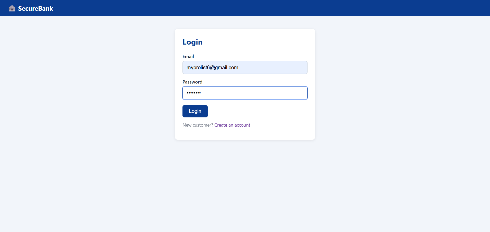
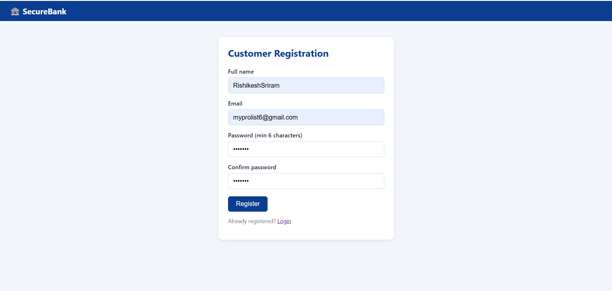
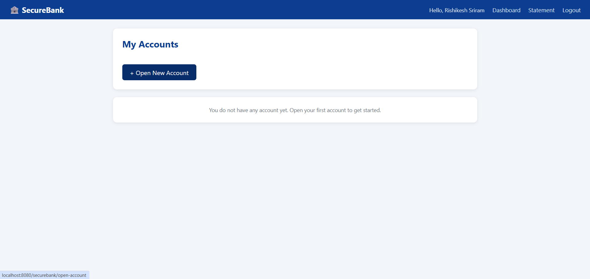
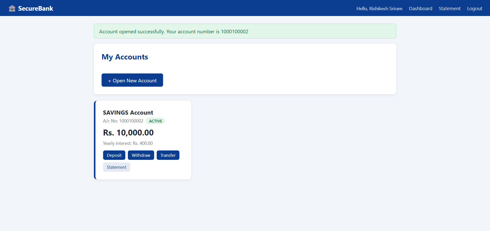
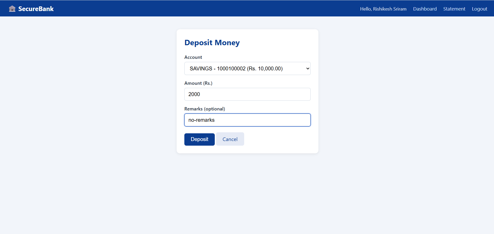
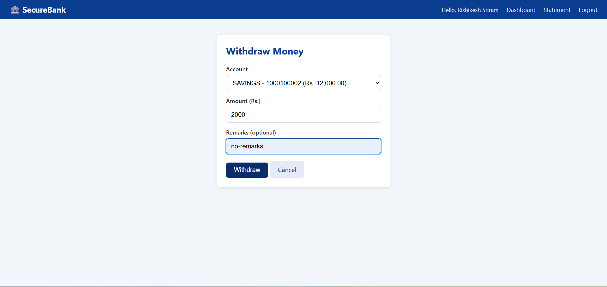
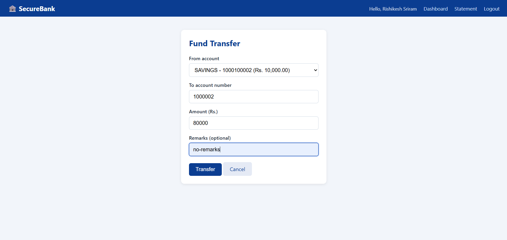
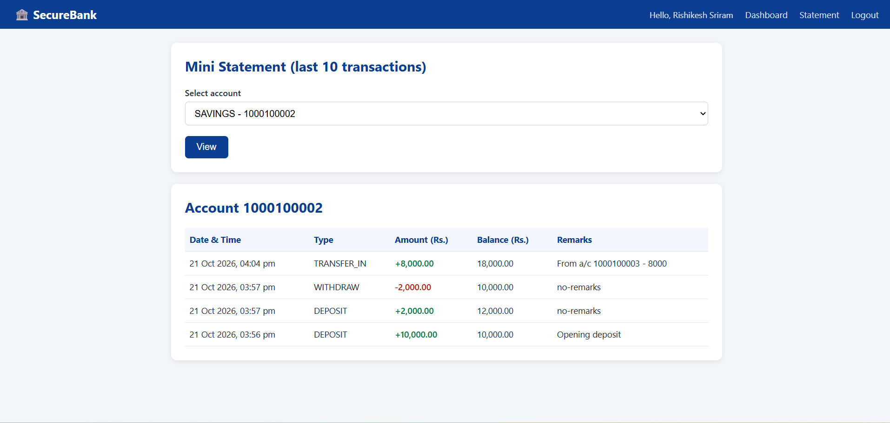

# 🏦 SecureBank – Banking Management System

A web-based banking application built with **Java, Servlets, JSP, JDBC and MySQL**, following the **MVC + DAO** pattern.
The project focuses on applying core **OOPs concepts** and **JDBC transaction management** in a realistic domain.

## ✨ Features
**Customer**
- Register / Login (salted SHA-256 password hashing, session based)
- Open Savings or Current account
- Deposit, Withdraw, **Fund Transfer** (atomic – commit / rollback)
- Mini statement (last 10 transactions)

**Admin**
- View all customers and accounts (SQL JOIN)
- Freeze / Unfreeze any account

**Security & quality**
- `AuthFilter` protects every page; `/admin` is role-restricted (403 for customers)
- `PreparedStatement` everywhere (no SQL injection), `<c:out>` in JSP (no XSS)
- Row-level locking (`SELECT ... FOR UPDATE`) – safe for concurrent withdrawals
- Lock ordering in transfers – no deadlocks
- Session fixation protection, 15 min session timeout, no-cache headers on private pages
- Post-Redirect-Get after every form submit (no duplicate transactions on refresh)
- JSPs live inside `WEB-INF` – reachable only through controllers

## 🧠 OOPs concepts used

| Concept | Where |
|---|---|
| Abstraction | `abstract class Account`, `interface AccountDAO / UserDAO / TransactionDAO` |
| Inheritance | `SavingsAccount`, `CurrentAccount` extend `Account` |
| Polymorphism (overriding) | `withdraw()`, `calculateInterest()` behave differently per account type |
| Polymorphism (overloading) | `BankService.transfer(...)` with / without remarks |
| Encapsulation | private `balance`, changed only via `deposit()/withdraw()` |
| Custom exceptions | `BankException` → `InsufficientBalanceException`, `AccountNotFoundException` |
| Factory method | `Account.of(type, ...)` |
| Collections | `List<Account>`, `List<Transaction>` |

## 🏗️ Architecture
```
Browser → AuthFilter → Servlet (Controller) → BankService → DAO (JDBC) → MySQL
                              ↓
                          JSP (View, in WEB-INF)
```
```
src/main/java/com/securebank/
├── model/       Account, SavingsAccount, CurrentAccount, User, Transaction
├── dao/         *DAO interfaces + *DAOImpl (JDBC)
├── service/     BankService (business logic + transactions)
├── controller/  Login, Register, Logout, Dashboard, OpenAccount, Transaction, Statement, Admin servlets
├── filter/      AuthFilter
├── exception/   BankException & subclasses
└── util/        DBConnection, PasswordUtil, InputUtil
src/main/webapp/WEB-INF/views/   JSP pages
sql/schema.sql                   tables + default admin
```

## 🗄️ Database
`users` ⟵ `accounts` ⟵ `transactions` (foreign keys, InnoDB). See `sql/schema.sql`.

## 🚀 How to run
**Requirements:** JDK 17+, Maven, MySQL 8, **Apache Tomcat 10.1 / 11** (Jakarta EE)

1. Create the DB:  `mysql -u root -p < sql/schema.sql`
2. Copy `src/main/resources/config.properties.example` → `config.properties` and set your MySQL user/password
3. Build: `mvn clean package`
4. Copy `target/securebank.war` to Tomcat's `webapps/` and start Tomcat
   (or in Eclipse/IntelliJ: add the project to a Tomcat server)
5. Open **http://localhost:8080/securebank/**

> ℹ️ This project uses `jakarta.*` (Servlet 6) so it needs **Tomcat 10.1 or 11**. For Tomcat 9 / `javax.*`, change imports back and use the javax servlet-api dependencies.

**Default admin:** `admin@securebank.com` / `Admin@123` (change after first login in a real deployment)

## 💡 Business rules
| | Savings | Current |
|---|---|---|
| Min opening deposit | Rs.1000 | Rs.500 |
| Withdrawal rule | balance must stay ≥ Rs.1000 | overdraft up to Rs.5000 |
| Interest | 4% p.a. | none |

## 🔮 Future improvements
Spring Boot + REST APIs, JUnit tests, HikariCP connection pooling, BCrypt, `BigDecimal` for money, OTP/email verification, CSRF tokens.

## Screenshots

### Login


### Register


### Dashboard


### Open Account


### Deposit


### Withdraw


### Transaction


### Statement

